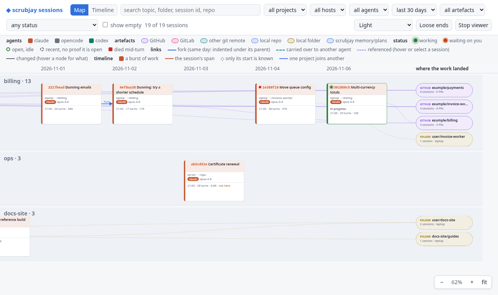
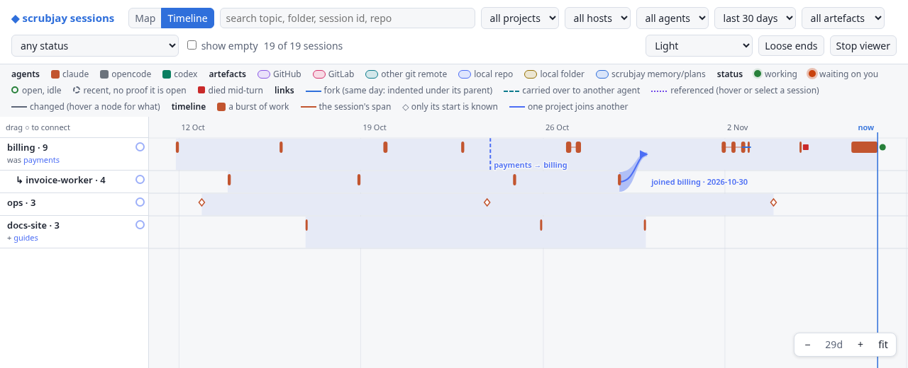

# The session viewer

`/sjview` opens every session from every machine and agent in one browser page. See what ran, what is
still running, what each session changed and how your projects fit together, then pick up any of it.



| You want to… | Use |
|---|---|
| See what is running or waiting on you | The [status menu](#which-sessions-are-alive) |
| See when work happened, and what ran in parallel | The [timeline](#the-timeline) |
| Find which session changed a repo, and how | [Where the work landed](#where-the-work-landed) |
| Continue a session, even one from another machine | A [session's panel](#a-sessions-panel) |
| Start a new session that knows about several old ones | A [context pack](#context-packs) |
| Tie together a renamed, merged or nested project | [Connecting projects](#connecting-projects) |
| Fix a folder that moved | [A path that moved](#a-path-that-moved) |
| Find work you never finished | [Loose ends](#loose-ends) |

## Start and stop

| Command | What it does |
|---|---|
| `/sjview` | Starts the viewer and prints its address |
| `/sjview <project>` | Opens on one project |
| `/sjview status` | Says whether it runs, and where |
| `/sjview stop` | Stops it |

The project name need not be exact: `widget`, `WIDGET_API` or `widgt-api` all find `widget-api`. When
several fit, the newest wins and the others are listed. With no likely match, it shows every project.

The viewer runs only while you use it. It stops on `/sjview stop`, on the page's **Stop viewer** button,
or after 30 minutes without a request. On a machine you reach over SSH, forward the port it prints:

```sh
ssh -L 7787:127.0.0.1:7787 <host>
```

`bin/sj-view.sh` also takes `--port N`, `--idle MIN` (`0` keeps it running) and `--no-open`.
`SCRUBJAY_VIEW_PORT` and `SCRUBJAY_VIEW_IDLE` set the defaults ([reference](reference.md)).

## Two views of the same sessions

**Map** and **Timeline** in the header switch views. Filters, the selected session and the context pack
carry over, and the page remembers which view you left it on.

| | Map | Timeline |
|---|---|---|
| Reads as | A card per session, a column per day | A bar per burst of work, on a true time axis |
| Shows best | What a session is and what it changed | When work happened, and how projects joined |
| Empty days | Left out | Kept, so gaps show |

### The map

A card shows the session id and topic, where it ran, the agent and model, its summary, and when, how
long and how big. Each agent has its own colour: Claude's clay, opencode's grey, codex's green.

Lanes with an open session come first, then the most recently active. Only the cards near the view are
drawn, so a large catalogue stays quick.

### The timeline



A lane per project, with now at the right edge. It opens on the last two weeks. Each lane is as tall as
the time in view needs, so quiet projects stay thin.

| Mark | Meaning |
|---|---|
| Solid bar | A burst of work, from the raw transcript's timestamps. 20 minutes of silence ends a burst |
| Thin line between bars | The session's whole span, so one left open for a week reads as the hours it was busy |
| ◇ | No raw transcript on this machine: only the start is known, so it gets no made-up length |
| Shaded band | The project's life, from its first session to its last |
| Blue line and `now` | The present. Open sessions run up to it |

Shift+drag along a lane to gather that stretch of sessions into a [context pack](#context-packs).

## Which sessions are alive

Active means a harness process holds the session open, not that something happened lately. Marks sit in
a card's title, or at the end of a timeline bar.

| Mark | State |
|---|---|
| Filled green dot | Working |
| Orange dot | Waiting on you |
| Hollow green ring | Open and idle |
| Red square | Died mid-turn: its process went while it was working |
| Dashed grey ring | Recent: a turn ended within 15 minutes, with no process to confirm it |

Only this machine's processes can be asked, so a session on another machine is at best recent.

The status menu filters by any state, or by all sessions open here, and counts each. It looks past the
date and **show empty** filters, so a live session is never hidden by its age. Marks and counts refresh
every 10 seconds.

## How sessions relate

| Relation | Looks like | Means |
|---|---|---|
| Fork | Solid arrow | Branched off another session. Same day: indented under its parent |
| Carry-over | Dashed arrow naming the agent | Continued in a different agent as a new session |
| Reference | Dotted line, on hover or selection | A session you named by id, or the agent pulled from the archive |
| Hand-off | One card, `laptop → desk` | The same session continued on another machine with `/sjresume` |

Selecting a session fades everything unrelated and tags each relative with how it is related.

## Where the work landed

Right of the map are the things sessions changed, each a pill in its kind's colour: a GitHub repo, a
GitLab repo, another git remote, a local repo, a local folder, or scrubjay's memory and plans. A line
joins each session to what it changed. Hover either end to see what happened there ("PR #42 merged · 3
commits · 2 files").

Click a repo for its **milestones**: per session, newest first, the PRs, issues, releases, branches,
pushes, commits and files written, with PRs and issues linked to the forge.

This comes from the archived transcripts: the files the agent wrote and the `git`, `gh` and `glab`
commands it ran, with their output. A repo is named by the remote that output shows or, failing that,
on this machine, by the folder's `origin`. A fork shows only what it did after branching. The archive
is read in the background on start and cached, so a later start reads only new transcripts.

## A session's panel

Click a session for everything scrubjay holds on it:

- every catalogue row, so you see how the topic moved
- its forks, relatives and artefacts
- where its transcript is archived
- **Read transcript**, condensed or in full
- the command that continues it: the harness's own resume for a session from this machine, or
  `sj-resume.sh` first for one from another machine ([hand-off](handoff.md))

## Connecting projects

A lane is a folder's name, so a rename, a merge or a subfolder reads as separate projects until you say
otherwise. A link says one project flows into another on a date, or always did. Make one in the
timeline:

1. Drag the ○ beside a lane's name onto another lane. Where you drop it is the date it joined.
   Dropping on the other's name means it was always the same project.
2. Read what the form says will happen. **⇄** swaps which flows into which.
3. Press **Connect**.

Clicking the ○ opens the same form, for picking both projects by name. The record decides the shape:

| What the record shows | Shape | Typical case |
|---|---|---|
| The other project had work before the date | A stream beside it, curving in on the date | Two projects merged |
| The other project had nothing before the date | One lane with a seam at the date | A rename or a move |
| No date | One lane all along, with `+ name` under its name | A subfolder or a clone |

Sessions keep the project they recorded, and sit in the lane their project stood in that day. The map
and the project filter treat linked projects as one. Click a join, or a name under a lane, to change or
undo it.

**Suggested** in the corner lists pairs that look like one, and a filled ○ marks them. Nothing is linked
until you confirm it, and **Not these** hides a pair in this browser. It looks for:

- a folder directly inside another project
- work landing on a repo named after another project
- two projects whose work lands on the same remote

A folder holding three or more projects counts as a shelf, not a project, so `~/code` suggests nothing.

Links are kept in `projects/` in your data repo, so they reach every machine, and transcripts are never
edited. `bin/sj-projects.sh` does the same from a terminal. A project can flow into only one other, and
linking works on names, so one name cannot be split: home folders on different machines share a lane.

## A path that moved

A folder missing from this machine shows **⚠ gone** on its card. In a session's or an artefact's panel,
**✎ moved?** records where it went, offering folders from the catalogue with the same name or git
remote. The move covers everything under the path, on that machine, in every session, and **undo**
takes it back.

Transcripts are never edited. A resumed session is told instead, in its first context, of each move its
history touches. A session whose own folder moved is staged there on resume, because the harness files
sessions by folder. Claude Code gets the note; opencode does not yet, and Codex only if its SessionStart
payload says `source: resume`.

Moves are kept in `moves/` in your data repo, so they reach every machine. `bin/sj-moves.sh` does the
same from a terminal. A move changes a path; a [link](#connecting-projects) says two projects are one.

## Context packs

A context pack starts a new session already briefed on old ones, from any machine or agent.

1. Gather up to 12 archived sessions: Shift+click them, use **Add to context pack** in a panel, or
   Shift+drag along a timeline lane.
2. Pick the agent and press **Build**.
3. Copy the command it gives you.

The primer runs oldest first and condensed. It holds about 240K characters shared between the sessions;
a long one loses its middle and is named. Packs stay in `~/.scrubjay/run/packs` for 7 days, readable
only by you.

## Loose ends

**Loose ends** in the header lists work from the last 30 days that shows no sign of finishing, each
linked to the session behind it:

- sessions that died mid-turn
- PRs still open
- branches pushed with no PR
- commits not pushed
- files not committed

A transcript cannot see a PR merged later by hand, so GitHub candidates are checked with one read-only
`gh pr list` per repo, and the last two come from this machine's repos. What could not be checked,
including every GitLab candidate, is marked **not checked**.

## Finding your way around

The search box matches topic, folder, session id, host, model and repo. The menus filter by project,
host, agent, age, artefacts and status. Sessions that recorded nothing stay hidden until you tick **show
empty**.

| Action | Map | Timeline |
|---|---|---|
| Pan | Drag, or hold Space and drag | Drag |
| Scroll | Wheel; Shift+wheel sideways | Wheel for lanes; Shift+wheel through time |
| Zoom | Ctrl+wheel or pinch | Ctrl+wheel |
| Pan by keys | Arrows or WASD | Arrows or WASD |
| Zoom by keys | `+` `−` | `+` `−` |
| Reset | `0`: actual size | `0`: the last two weeks |
| Show everything | `F` | `F` |
| Go to search | `/` | `/` |
| Add to a context pack | Shift+click | Shift+click, or Shift+drag along a lane |

Addresses you can keep end in `#sid=<id>` (a session's panel), `#read=<id>` (its transcript), `#art=<id>`
(an artefact's milestones), `#project=<name>` (one project) or `#view=timeline`.

The menu beside **Stop viewer** sets the colours: your system's light or dark, or a preset (Light, Dark,
Nord, Solarized light and dark, Gruvbox, High contrast, Colour-blind safe). This browser remembers it.

## What it reads and writes

The viewer reads the archive and never changes it. It listens on `127.0.0.1` alone and answers only
requests carrying the token in the address it prints.

| It writes | Where | Reaches other machines |
|---|---|---|
| A moved path | `moves/` in your data repo | Yes |
| A project link | `projects/` in your data repo | Yes |
| A context pack | `~/.scrubjay/run/packs`, kept 7 days | No |
| Its caches | `~/.scrubjay/run` | No |

A machine with no archive (`rsync-wg`) shows the map but cannot open transcripts or show bursts of work.

## Nextcloud links

If the same folders are in a Nextcloud, set these in `~/.config/scrubjay/config`:

```sh
SCRUBJAY_VIEW_NEXTCLOUD=https://cloud.example
SCRUBJAY_VIEW_NEXTCLOUD_MAP=/mnt/nas=/NAS
```

Every path under that folder then gets an **☁ open** link: a session's folder, its transcript, a local
repo or folder, each file written. A folder opens in the Files app; a file opens its folder with the
file picked out. The link is checked when you click it, so a path that has gone opens the deepest folder
of it that still exists.
